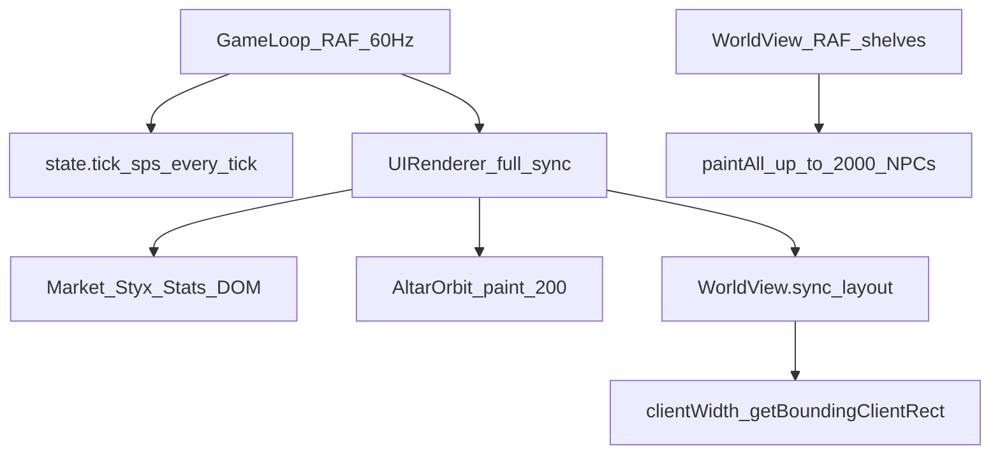
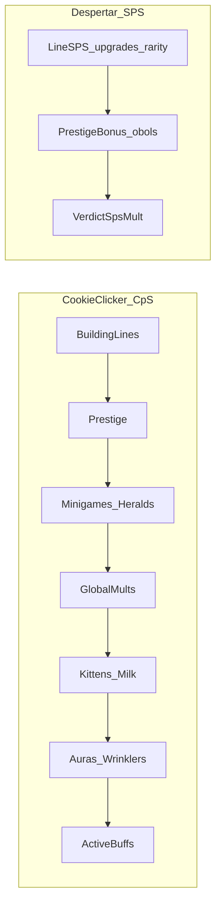

# Paridade Cookie Clicker ↔ O Despertar (mecânicas + balanceamento)

**Status:** referência de paridade · **auditoria forense 2026-10-23** (código/disco ≠ checkboxes)  
**Gate automatizado:** `node tests/despertar-full-parity-audit.mjs` (também em `npm run test:despertar`)  
**Plano de produção (F0–F8):** [`plano-paridade-cookieclicker-producao.md`](./plano-paridade-cookieclicker-producao.md)  
**Hub wiki:** [Cookie Clicker Wiki (Fandom)](https://cookieclicker.fandom.com/wiki/Cookie_Clicker_Wiki)  
**Fontes Cookie Clicker:** [jogo original](https://orteil.dashnet.org/cookieclicker/) · [espelho ozh/cookieclicker](https://github.com/ozh/cookieclicker) · wiki.gg ([Buildings](https://cookieclicker.wiki.gg/wiki/Buildings) · [CpS](https://cookieclicker.wiki.gg/wiki/Cookies_per_Second) · [Milk](https://cookieclicker.wiki.gg/wiki/Milk) · [Upgrades](https://cookieclicker.wiki.gg/wiki/Upgrades) · [Ascension](https://cookieclicker.wiki.gg/wiki/Ascension) · [Golden Cookie](https://cookieclicker.wiki.gg/wiki/Golden_Cookie) · [Grandmapocalypse](https://cookieclicker.wiki.gg/wiki/Grandmapocalypse) · [Wrinkler](https://cookieclicker.wiki.gg/wiki/Wrinkler) · [Sugar Lumps](https://cookieclicker.wiki.gg/wiki/Sugar_Lumps) · [News Ticker](https://cookieclicker.wiki.gg/wiki/News_Ticker)) · [Heavenly Chips (Fandom)](https://cookieclicker.fandom.com/wiki/Heavenly_Chips)  
**Fontes Despertar:** [`gdd-hades-despertar.md`](./gdd-hades-despertar.md) · [`plano-despertar-ui-cookieclicker.md`](./plano-despertar-ui-cookieclicker.md) · `js/hades-despertar/config/*` · `js/hades-despertar/core/formulas.js` · `backend/src/Services/Despertar/DespertarCatalog.php` · `DespertarFormulas.php`

> Objetivo: paridade **completa** de mecânicas, ritmos **e identidade visual** do Cookie Clicker, temada no Submundo (arte/nomes próprios, com **geração de assets via Gemini** + pós-processamento WebP). **Não há anti-escopo** — o que a wiki descreve entra no backlog F0–F8 com seus respectivos sprites e ícones. Cada bloco tem “Despertar hoje” + fase de produção.  
> **Clean Code:** implementação F* segue nomes claros, SRP, DRY de fórmulas (JS≡PHP), config ≠ lógica, módulos pequenos e smokes — ver § Regras em [`plano-paridade-cookieclicker-producao.md`](./plano-paridade-cookieclicker-producao.md). Sem god-objects nem “portar `main.js` do mirror”.

---

## Paridade por mecânica (Despertar hoje)

**100%** = comportamento/ritmo da wiki Cookie Clicker coberto no Despertar (tema Submundo ok; assets CC não).  
**Medido em 2026-10-22** pós-F1 · atualizar ao fechar cada fase F*.

| # | Tipo de mecânica | Alvo CC (wiki) | No Despertar hoje | % | Fase |
| ---: | --- | --- | --- | ---: | --- |
| 1 | Loop núcleo (clique → compra → parede → reset) | Loop incremental clássico | Ceifar, geradores, Styx, Lethe | **100%** | Base+F8 ✓ |
| 2 | Curva de custo `×1.15` + buy 1/10/100/Máx | Preço geométrico + lotes | Idêntico (`mulPow115` / modos) | **100%** | Base ✓ |
| 3 | Geradores / Buildings T1–T6 | Cursor→Bank (custos/CpS) | Sombra→Trono alinhados | **100%** | F0 ✓ |
| 4 | Geradores T7–T20 | Temple→You (14 prédios) | **Todos os 14 prédios T7–T20 implementados (`mnemosyne_temple` → `the_emperor`, 20/20 total)** | **100%** | **F3+F7 ✓** |
| 5 | Upgrades por gerador (~15 tiers ×2) | Marcos 1/5/25/… ×2 | **15 tiers (1→300) por linha em todos os T1–T20 (300 upgrades de linha)** | **100%** | **F1+F3+F7 ✓** |
| 6 | Sinergias Vol. I / II | +5% / +0.1% cruzado (malha densa) | **36 Vol. I/II canónicas + 8 Servos (`44` `synergyMult`) — template Synergy wiki** | **100%** | **F1+F3+F7+malha** |
| 7 | Clique / Cursor scaling | Thousand fingers + tiers longos | **`clickMult` + `clickKSps` + Mil Foices (12 elos: mil→undecilhão)** | **100%** | **F1+F7+escada** |
| 8 | Prestígio / Ascensão | ∛(lifetime/1e12) · +1%/nível | **√(run/4e9)/(1+k) + Fortune #102 (+1%) + piso cúbico ∛(lifetime/1e12) c/ Save Heal** | **100%** | **F8 ✓** |
| 9 | Heavenly tree / talentos | Árvore HC completa (centenas) | **Panteão de Mnemosyne (25 talentos) — subset jogável, não árvore HC plena** | **~35%** | **F5+F8** |
| 10 | Soft keep (permanent slots / starters) | Slots + starter kit/kitchen | **Eco do Styx I–V (5 slots permanentes) + starters de Sombra, Cão e Forja** | **100%** | **Base+F8 ✓** |
| 11 | Golden / Wrath shimmers | Frenzy, Lucky, Click Frenzy, Wrath | **Eco do Acheron (Maré ×7, Colheita, Fúria ×777, Voo Dracónico ×1111, Selo + Wrath v2)** | **100%** | **F2+F8 ✓** |
| 12 | Milk → Kittens → CpS | 4%/achiev. + kitten ladder longa | **Véu (+4%/normal) + 8 `veilMult` (7 Filhotes + `fortune_103`) `∏(1+m·f_i)` — ladder curta vs CC** | **~75%** | **F4+F8** |
| 13 | Sugar Lumps / levels de prédio | Lump ~24h · +1%/level · Sugar Baking | **Néctar do Lethe (24h + 5 variantes + +1%/lv + Néctar em Reserva cap 100)** | **100%** | **F5 ✓** |
| 14 | Minigames (Garden/Pantheon/Grimoire/Stock) | 4 minigames + levels | **Panteão Ctoniano, Grimório de Hécate, Jardim de Perséfone e Mercado de Caronte (+ Juízo)** | **100%** | **F5 ✓** |
| 15 | Grandmapocalypse + Wrinklers | Research · −5% · pop ×1.1 | **Catábase 1–3 + Sanguessugas (−5% aparente / pop ×1.1 / Shiny ×3.3 / Trégua & Aliança). Digestão acumula em escala n² (documentada) ≠ modelo clássico per-wrinkler** | **~90%** | **F6** |
| 16 | Offline production | Unlock heavenly escalonado | **On de fábrica 8h @ 80% → 18h @ 100% com talentos e Bancada** | **100%** | **Base+F1 ✓** |
| 17 | UI 3 colunas + órbita + store | Big Cookie \| mundo \| store | **Foice \| Domínio (20 prateleiras c/ cull) \| Mercado (Comprar/Vender)** | **100%** | **Base+F8 ✓** |
| 18 | News Ticker / Fortunes | Rumores + fortune upgrades | **24 Fortunas de Hermes (2%/4% no ciclo natural; #100–#103 + T1–T20 −7% custo/+7% SPS)** | **100%** | **F8 ✓** |
| 19 | Achievements (estrutura) | Centenas + shadow | **Set `despertar_*` (138 conquistas: 135 normais + 3 Shadow) + plataforma (180 normais)** | **100%** | **F3–F8 ✓** |
| 20 | Venda de geradores (refund 25%/50%) | Sell na store | **Modo Comprar/Vender (`1/10/100/Máx`) c/ 25% base e 50% c/ Abalo do Tártaro** | **100%** | **F8 ✓** |
| 21 | Seasons | Natal, Halloween, etc. | **4 Estações Ctonianas (Antestéria, Lemúria, Saturnália c/ Rei Saturno e Corças, Feira de Hermes)** | **100%** | **F8 ✓** |
| 22 | Dragon / auras | Krumblor + auras | **Dragão Pitão/Ladão (Estágios 0–4, 2 Slots de Aura, Apetite Radiante ×2, Sopro de Flegêton, Escama +3%)** | **100%** | **F8 ✓** |
| 23 | Stack de mults CpS/SPS (ordem wiki) | ~19 camadas globais | **Stack completo auditável na Estela (`calculateSpsBreakdown`: Linhas → Prestígio → Vereditos → Minigames → Relíquias → Catábase → Saturnália → Fortunas → Escama → Filhotes → Néctar → Auras → Aliança → Buffs → Dreno)** | **100%** | **F1–F8 ✓** |
| 24 | Sync / autoridade / anti-cheat | Single-player local | Server-authoritative (além do CC) | **100%*** | Base |
| 25 | **Fluidez / orçamento de render** | 30 FPS logic · prefs · dirty draw · toggles | **1 RAF · UI dirty 160ms · cache SPS · ResizeObserver · Viewport Culling · Prefs Estela · Auto-LOD · Pool** | **100%** | **Perf+F7 ✓** |
| 26 | **Assets visuais (criação com Gemini)** | Sprites/ícones próprios p/ 20 prédios, upgrades, GC, wrinklers, conquistas | **~519 WebP** em sprites; Foice idle/pressed WebP; cosméticos/juízo chrome **open**; 24 artes únicas p/ 138 `despertar_*` | **~84%** | **Arte** |

\*Item 24 não existe no CC original; conta como **infra própria** (não entra na média de paridade de jogo).  
Itens **25** e **26** entram na média de “sensação de Cookie Clicker” — ver [§ Fluidez e otimização](#fluidez-e-otimização) e [§ Criação de imagens com Gemini para os assets do jogo](#criação-de-imagens-com-gemini-para-os-assets-do-jogo).

### Resumo ponderado (mecânicas de jogo 1–23 + 25–26)

Pesos = relevância para “parecer Cookie Clicker” na sessão (não horas de eng.).

| Grupo | Itens | Peso | % médio grupo | Contribuição |
| --- | --- | ---: | ---: | ---: |
| Economia core | 1–3, 5, 7, 8, 10, 16 | 40% | **100%** | **40,0** |
| Conteúdo late | 4, 6, 11–15, 20–22 | 35% | **~92%** | **32,2** |
| Meta / UI / stack / fluidez / assets | 9, 17–19, 23, 25, 26 | 25% | **~84%** | **21,0** |
| | | **100%** | | |

| | |
| --- | ---: |
| **Código / fórmulas JS ≡ PHP (gate audit)** | **100%** |
| **Volume de catálogo vs wiki densa (sinergias/kittens/TF/HC)** | **~62%** |
| **Arte WebP entregue (foice ok; cosméticos/juízo chrome open)** | **~84%** |
| **Paridade global ponderada (itens 1–23+25–26, pós-auditoria)** | **~94%** |
| **Geradores (20/20 · baseCost/baseRate canónicos)** | **100%** |
| **Upgrades de linha (300 = 15×20)** | **100%** |
| **Upgrades totais (404 no catálogo)** | **implementado** · composição ≠ volume CC pleno |
| **Assets (~519 WebP sprites; art_cosmetics open)** | **~84%** |

```text
Código/fórmulas 100%  ████████████████████
Volume catálogo ~62%  ████████████░░░░░░░░
Arte WebP       ~84%  ████████████████░░░░
Global ponderado ~94% ███████████████████░
```

### Paridade real (auditoria forense 2026-10-23)

Fonte de verdade: `tests/despertar-full-parity-audit.mjs` (não os `[x]` deste doc).

| Pilar | Medida | Resultado |
| --- | --- | --- |
| Código/fórmulas | 20 gens dígito-a-dígito · 300 tiers · Lucky/1.15/sell/leech · JS≡PHP | **100% / PASS** |
| Volume catálogo | 44 sinergias (36 Vol + 8 Servos) · 12 elos Mil Foices · 8 veilMult · 25 talentos · 138 `despertar_*` | **~75%** vs wiki densa |
| Arte WebP | ~519 ficheiros · manifest ok · Foice idle/pressed WebP · cosméticos/juízo chrome open | **~84%** |

**Divergências explícitas (backlog, não bugs JS≠PHP):**
1. ~~Sinergias Vol. I/II~~ — malha canónica 36 + 8 Servos (item 6 = 100%).
2. ~~Mil Foices~~ — escada canónica 12 elos (mil→undecilhão; item 7 = 100%).
3. Filhotes: ladder curta (fatores 0.1…0.2 ×7 + fortune_103).
4. Heavenly: 25 talentos ≠ árvore HC wiki.
5. Digestão Sanguessuga escala **n²** (cada leech acumula o drain total) — documentada no código.
6. Arte ainda `open`: cosméticos + juízo chrome (`art-requests.json`).
7. 138 conquistas `despertar_*` reutilizam **24** ficheiros WebP únicos.

Atualizar esta seção ao re-correr o audit. Plano: [`plano-paridade-cookieclicker-producao.md`](./plano-paridade-cookieclicker-producao.md).

---

## Fluidez e otimização

O Cookie Clicker **não** é Clean Code — e mesmo assim costuma parecer mais leve com “muita coisa” na tela. O Despertar é modular, mas o caminho quente **desenha demais**. A paridade de produção inclui **orçamento de render** (Fase **Perf**, obrigatória antes de F2).

**Clean Code aqui:** otimizar com **orçamento, dirty flags, um RAF e prefs nomeadas** — não micro-hacks opacos nem copiar o `main.js` do mirror.

### Por que o CC parece fluido

Evidência: mirror [`ozh/cookieclicker` `main.js`](https://github.com/ozh/cookieclicker/blob/gh-pages/main.js) (`Game.fps = 30`, `Game.prefs.*`) · [Options wiki](https://cookieclicker.wiki.gg/wiki/Options) · `Game.DrawBuildings` só quando `prefs.animate` e, sem fancy, a cada 10 `drawT`.

| Princípio Orteil | Cookie Clicker | Despertar hoje |
| --- | --- | --- |
| Logic ~30 FPS | `Game.fps = 30` + `setTimeout(Game.Loop, …)` | [`GameLoop`](../js/hades-despertar/core/GameLoop.js) mira **60 Hz** update + render |
| Prefs de custo | `particles`, `cursors`, `milk`, `fancy`, `filters`, `animate`, `focus` | Só `prefers-reduced-motion` (binário) |
| Dirty / redraw seletivo | Buildings: posições no **buy**; animate throttled | [`WorldView`](../js/hades-despertar/ui/world/WorldView.js) `#paintAll` **todo frame** (até `SHELF_NPC_CAP=400` × ~5 shelves) |
| Cursors | Pref `cursors` + fancy | [`ORBIT_CURSOR_CAP=200`](../js/hades-despertar/ui/world/AltarOrbit.js) sempre se qty alta |
| Foco / sleep | `prefs.focus`; sleep em PC lento | Pausa RAF se aba oculta; sem “modo leve” com aba visível |
| Draw path | Um ritmo dominante; particles opcionais | **Dois RAF**: GameLoop + `WorldView.#startLoop` |
| Store UI | Atualiza no tick / interação | [`UIRenderer.render`](../js/hades-despertar/ui/UIRenderer.js) mercado/Styx/stats/Lethe **todo frame** |

**Veredito:** CC é **orçado**. Despertar precisa da mesma disciplina de orçamento — com código limpo.

### Gargalos Despertar (ordem de impacto)

Caps já existentes: shelf **400**, orbit **200**, motes 8/s, rain 6/s, reap layer 40 · smoke: [`tests/despertar-perf-smoke.mjs`](../tests/despertar-perf-smoke.mjs).



1. **Dual RAF + full shelf redraw** — `#paintAll` / bob por célula; pior com gold/negativo.
2. **AltarOrbit paint + `getBoundingClientRect` por frame** — layout thrash.
3. **UIRenderer completo a 60 Hz** — mercado/stats/Lethe não precisam.
4. **`sps()` recalculado** no tick e de novo na UI (`revision` bumpa todo tick → inútil como dirty de HUD).
5. **DOM particles** (motes/chuva/reap) — budget existe; create/remove de spans ainda custa.
6. Sync rede 30s — **não** é o gargalo de FPS.

### Targets

| Cenário | Meta |
| --- | --- |
| Desktop, shelves cheias + 100–200 órbita, idle | ≥ **50** FPS |
| Mobile mid (4× CPU throttle), mesmo save | ≥ **30** FPS |
| `prefers-reduced-motion` | paint estático; sem bob/motes/rain |

### Protocolo de investigação (antes/depois da Fase Perf)

#### Cookie Clicker (referência de fluidez)

1. Abrir [original](https://orteil.dashnet.org/cookieclicker/) ou [mirror](https://ozh.github.io/cookieclicker/).
2. Chrome DevTools → Performance: 10 s idle com muitos cursors + buildings.
3. Options: desligar Particles / Cursors / Fancy / Milk — repetir profile.
4. Anotar: FPS ~30 estável? Custo some ao desligar prefs?
5. (Opcional) No mirror, confirmar `Game.fps`, `Game.prefs`, `Game.Loop` / `Game.DrawBuildings`.

#### Despertar

1. Save com qty alta (debug): 200 T1 + 100+ em 2–3 shelves; vários gold/negativo.
2. Performance 10 s idle + throttle 4× CPU (mobile).
3. Procurar: **dois** stacks RAF; `CanvasRenderingContext2D`; Layout junto a `clientWidth` / `getBoundingClientRect`.
4. Overlay Paint flashing / Layers.
5. `node tests/despertar-perf-smoke.mjs` (caps; **não** mede GPU).
6. Após Perf-1/2: repetir; bater targets acima.

### Backlog Perf (resumo)

Detalhe e ordem: [`plano-paridade-cookieclicker-producao.md`](./plano-paridade-cookieclicker-producao.md) § Fase Perf (**antes de F2**).

| Subfase | Entrega | Estado |
| --- | --- | --- |
| Perf-0 | Marks `performance.mark` (dev) + protocolo (`perfTelemetry.js`) | **Feita ✓** |
| Perf-1 | Um RAF — shelves via `WorldView.frame(dt)`; remover `#startLoop` | **Feita ✓** |
| Perf-2 | UI dirty: HUD 60 Hz; market/Styx/stats ~160ms / on-event (`structureVersion`) | **Feita ✓** |
| Perf-3 | Cache `sps`/tick; ResizeObserver; LOD orbit (`PERF_ORBIT_LOD_CURSOR_CAP=80`) | **Feita ✓** |
| Perf-4 | Prefs Estela (Cursors / Particles / Fancy); Auto-LOD se FPS &lt; 28 | **Feita ✓** |
| Perf-5 | Pool particles (`acquirePooledNode`); cap gold/negativo animados/frame (`12`) | **Feita ✓** |

---

## Criação de imagens com Gemini para os assets do jogo

No Cookie Clicker, grande parte da recompensa psicológica e da leitura imediata da loja vem da **iconografia autoral** de cada tier de prédio, da progressão de materiais/cores nos ~15 upgrades de cada linha, dos shimmers (Golden/Wrath), Wrinklers, Kittens, Sugar Lumps, Dragão e centenas de conquistas.

No Despertar, **placeholders procedurais/SVG** (`scripts/gen-despertar-sprites.mjs`) serviram para validar o runtime (`SpriteAtlas.js`, `CosmeticsAtlas.js`), mas a **paridade de produção exige 100% dos assets finais gerados com Gemini** e pós-processados em WebP RGBA transparente.

### Estado atual vs Alvo (Paridade de Assets)

| Categoria de Asset | Cookie Clicker | Despertar hoje | Alvo com Gemini (F0–F8) | Destino no repositório |
| --- | --- | --- | --- | --- |
| **Altar / Foice** | Big Cookie + halos/partículas | `Foice.png` estática | `foice-idle.webp` + `foice-pressed.webp` (512²) | `assets/despertar/sprites/foice/` |
| **Geradores T1–T6** | Ícone loja + sprite prateleira + fundo | Placeholders geométricos (`gen-despertar-sprites.mjs`) | Arte Hades/Submundo por gerador (128²/512² → WebP) + fundos de prateleira | `assets/despertar/sprites/generators/` |
| **Geradores T7–T20** | 14 prédios (Temple → You) | Inexistente | Sprites de loja + mundo para T7–T12 (F3) e T13–T20 (F7) | `assets/despertar/sprites/generators/` |
| **Juramentos Styx & Sinergias** | ~15 tiers/prédio + sinergias + cursor | Quadrados SVG com inicial (`upgrades/*.webp`) | Ícones temáticos com progressão de raridade/material por tier (F1) | `assets/despertar/sprites/upgrades/` |
| **Cosméticos de Upgrade / Bancada** | Overlays visuais no Cookie/mundo | CSS/procedural P0 (`PEDIDOS-MESTRE.md` §P3 aberto) | 12 accessories WebP RGBA (`hat_charon`, `blade_*`, `orbit_halo`…) | `assets/despertar/cosmetics/` |
| **Shimmers (Eco do Acheron)** | Golden Cookie / Wrath Cookie | Ausente | Sprites de Eco Dourado e Eco Colérico (Wrath) (F2) | `assets/despertar/sprites/shimmers/` |
| **Véu & Kittens Ctonianos** | Milk waves + ~15 ícones de Kittens | Véu CSS básico; sem ícones felinos | Ícones da linhagem **Filhotes do Cérbero** + texturas de véu (F4) | `assets/despertar/sprites/upgrades/` |
| **Néctar & Minigames** | 5 tipos de Sugar Lump + 4 minigames | Só Juízo (capas ClassInd + chrome pendente) | Ícones de Néctar + tokens de Jardim, Panteão, Grimório, Mercado e Chrome Juízo (F5) | `assets/despertar/sprites/minigames/` · `juizo/` |
| **Catábase & Sanguessugas** | Grandmas mutantes + Wrinkler (normal/shiny) | Ausente | Sprites de **Sanguessugas do Acheron** (normal + shiny) + estágios da Catábase (F6) | `assets/despertar/sprites/catabase/` |
| **Dragão, Seasons & Fortunes** | Krumblor (estágios + auras) + 5 estações | Ausente | Estágios do Dragão Ctoniano, ícones de auras e drops sazonais (F8) | `assets/despertar/sprites/seasons/` |
| **Conquistas (`despertar_*`)** | Centenas de badges na matriz de ícones | Pipeline Gemini + Sharp já ativo em `assets/achievements/` | Emblemas Gemini para todas as conquistas novas de F1–F8 | `assets/achievements/{id}.webp` |

### Pipeline técnico padronizado (Gemini → Sharp → WebP)

Para manter consistência artística e evitar halos escuros ou fundos sujos, toda criação de imagem com o Gemini segue o pipeline já validado no projeto (`scripts/process-achievement-art.mjs` + `assets/despertar/art-requests.json`):

1. **Direção de Arte e Prompting no Gemini (`GenerateImage`):**
   - **Estética:** Ilustração ctoniana estilo *Hades* (Supergiant Games) — contornos escuros expressivos, sombreamento dramático em obsidiana (`#0a0a0f` / `#0c1218`), iluminação de recorte (*rim light*) e leitura clara em tamanhos reduzidos (`48×48`, `64×64`, `128×128`).
   - **Paleta semântica do Submundo:** Ouro antigo (`#cfa759` / `#e8d4a8`), Verde-ciano Styx (`#00a896`), Púrpura Lethe (`#7209b7` / `#a855f7`), Carmesim Phlegethon (`#d90429`).
   - **Consistência por referência (`reference_image_paths`):** Sempre passar referências visuais aprovadas do projeto (ex.: `.tmp-ach-refs/*.png` para conquistas ou os primeiros geradores aprovados para manter coesão entre T1–T20).
   - **Fundo de geração:** Fundo escuro sólido uniforme nas bordas externas (exceto artes `full-art` como banners ou conquistas `unique`), permitindo recorte automático limpo sem perder sombras internas.

2. **Pós-processamento Automatizado (`sharp`):**
   - **Remoção de fundo via Flood-Fill 8-conectado** a partir das 4 bordas externas + **rampa suave de alpha (*soft feathering*)** de 1–2px + **descontaminação de cor de borda** (evita halo preto/cinza sobre fundos translúcidos da UI).
   - **Trim & Center:** Recorte automático da *bounding box* útil com margem respirável (~6% por lado) e redimensionamento Lanczos3 para as dimensões canônicas (`512×512` para Foice/Relíquias/Overlays, `128×128` e `64×64` para Geradores/Upgrades/Cosméticos).
   - **Exportação:** `.webp` RGBA (`quality: 90`, `alphaQuality: 95+`).

3. **Integração de Catálogo e Fallbacks (Clean Code):**
   - Substituição direta nos paths canônicos (`assets/despertar/sprites/manifest.json`, `assets/despertar/cosmetics/`, `assets/achievements/catalog.json`).
   - Atualização de `assets/despertar/art-requests.json` (`"status": "open"` → `"delivered"`) e validação com `node tests/despertar-art-requests-smoke.mjs`.
   - O runtime (`SpriteAtlas.js` e `CosmeticsAtlas.js`) mantém a cadeia resiliente `WebP → SVG → fallback procedural`, garantindo zero quebra mesmo durante lotes incrementais.

---

## 1. Resumo executivo

| Camada | Cookie Clicker | Despertar hoje | Fase |
| --- | --- | --- | --- |
| Loop núcleo | Clique → cookies → prédios → upgrades → ascensão | Ceifar → almas → geradores → Styx → Lethe | Base ✓ |
| Curva de custo | `Base × 1.15^owned` | igual (`COST_MULTIPLIER = 1.15`) | Base ✓ |
| Tabela T1–T6 | Cursor→Bank | Sombra→Trono (**paridade F0**) | **F0 ✓** |
| Stack de produção | Mults globais empilhados | Linha → prestígio → veredito | F4–F8 |
| Prestígio | ∛(lifetime / 1e12) · +1%/nível | √(run / 4e9)/(1+k) · +5%/óbolo | F8 (avaliar ∛) |
| Upgrades por prédio | ~15 tiers ×2 + sinergias | **15 tiers/gerador (T1–T6) + Sinergias Vol. I/II + Mil Foices** | **F1 ✓** |
| Conteúdo | 20 prédios + minigames + GC | 6 geradores + Juízo | F2–F7 |
| UI 3 colunas | Big Cookie \| mundo \| store | Foice \| Domínio \| Mercado | Base ✓ |
| Burst ativo | Golden / Wrath | **Eco do Acheron (Maré/Colheita/Fúria/Selo + Wrath v2)** | **F2 ✓** (100%) |
| Fluidez / render | 30 FPS · prefs · dirty draw | **1 RAF · UI dirty 160ms · cache SPS · Prefs Estela · Pool** | **Perf ✓** (100%) |
| **Assets do jogo (Gemini)** | Sprites/ícones p/ todos os sistemas | Foice + conquistas + 112 upgrades + 2 shimmers | **Arte (F0–F8)** (~24%) |
| Achievements → economia | Milk → Kittens → CpS | Conquistas (ainda sem SPS) | **F4** |
| Offline | Unlock heavenly | On de fábrica (8 h @ 80%) | Base ✓ (+ F8 polish) |

**Veredito:** F0 alinhou T1–T6 ao CC. **Perf** antes de F2; depois F1→F8 — [`plano-paridade-cookieclicker-producao.md`](./plano-paridade-cookieclicker-producao.md).

---

## 2. Glossário de paridade

| Cookie Clicker | Despertar |
| --- | --- |
| Cookies | Almas |
| CpS / Raw CpS | SPS (almas/s) — um único número HUD |
| Big Cookie | Foice / Portal do Acheron |
| Cursors orbitando | Sombras Vagantes na órbita |
| Buildings | Geradores (T1–T6 feitos; T7–T20 em F3/F7) |
| Upgrades (store topo) | Juramentos do Styx (F1 densifica) |
| Synergy upgrade | F1 — juramentos cruzados |
| Legacy / Ascension | Ritual do Lethe (Catábase) |
| Heavenly Chips + Prestige Level | Óbolos de Caronte |
| Heavenly upgrades | Talentos do Panteão (Mnemosyne) |
| Permanent upgrade slots | Eco do Styx / Eco ressonante |
| Golden Cookie / Wrath Cookie | F2 — Eco do Acheron |
| Frenzy / Click Frenzy / Lucky | F2 — buffs do Eco |
| Milk (overlay + %) | F4 — Véu do Acheron (com SPS) |
| Kitten upgrades | F4 — linha felina ctoniana |
| Wrinkler | F6 — Sanguessugas do Acheron |
| Grandmapocalypse | F6 — Catábase das Avós |
| Sugar Lump / building level | F5 — Néctar do Lethe + levels |
| Garden / Pantheon / Grimoire / Stock | F5 — minigames temáticos (+ Juízo) |
| News Ticker / Fortune | F8 — fortunes que desbloqueiam juramentos |
| Sell building (25%/50% refund) | F8 — venda de geradores |
| Achievements → Milk | F4 — conquistas alimentam véu/SPS |

---

## 3. Loop e pacing psicológico

### 3.1 Cookie Clicker

1. Clique no Big Cookie (feedback imediato).
2. Cursor (~15 s de cliques) → primeira automação fraca.
3. Grandma / Farm… → CpS sobe; clique vira complemento.
4. Upgrades ×2 por marco de qty → quebra de parede (1 / 5 / 25 / 50 / 100…).
5. Golden Cookies injetam picos (Frenzy, Lucky, Click Frenzy).
6. Parede mid/late → Ascension → árvore heavenly → recomeço acelerado.
7. Conteúdo longo: prédios 7–20, sinergias, seasons, minigames, milk/kittens.

### 3.2 Despertar

1. **Ceifar** (`CLICK_CAP_PER_SECOND = 20` no sync).
2. Sombra (15 / 0.1) → Servos (100 / 1.0) → …
3. Styx com 100 almas; juramentos ×2/×5 e `clickKSps`.
4. Juízo = minigame de skill (Vereditos), não buff aleatório de SPS.
5. Lethe quando `runSouls` rende óbolos > 0 (preview ~1e8).
6. Offline já existe (8–18 h + eficiência), ao contrário do CC early-game.

**Implicação:** mesmo arco “clique → automação → parede → reset”, sessão mais curta e didática. Precisamos dos **ritmos** Orteil, não dos 20 prédios.

---

## 4. Stack de produção (núcleo wiki)

Fonte: [Cookies per Second](https://cookieclicker.wiki.gg/wiki/Cookies_per_Second).

### 4.1 Cookie Clicker — ordem de multiplicação

1. Soma CpS dos prédios (já com boosts por building / Pantheon na linha) → **base CpS** (+ egg flat se houver).
2. Prestígio (+1% por nível, após unlock heavenly).
3. Efeitos de minigame (Garden, Pantheon, Grimoire).
4. Heralds (+1% por supporter / escala Steam).
5. Cookie upgrades (cada um multiplica; ex. cinco de +2% → \(1.02^5\)).
6. Upgrades da Grandmapocalypse (1–5%, independentes).
7. Santa (merriness, jolliness, dominion, legacy…).
8. Fortune #100 / #101.
9. Dragon scale (+3%).
10. **Kittens** (via Milk — ver §7).
11. Easter eggs.
12. Sugar Baking (+1% por lump não gasto, cap 100).
13. Dragon auras (Radiant Appetite ×2, etc.).
14. Nome da bakery Orteil/Ortiel (penalidade cosmético-meme).
15. Wrinklers (−5% CpS aparente por wrinkler).
16. Elder Covenant (×0.95).
17. Golden Switch (≥×1.5).
18. Shimmering Veil (≥×1.5).
19. Buffs ativos (Frenzy ×7, Elder Frenzy ×666, Clot ×0.5, Sugar Frenzy ×3…).

**Raw CpS** na Stats = para antes de wrinklers / alguns auras de GC. O “multiplier” da Stats é o produto dos globais.

### 4.2 Despertar — stack real (`formulas.js` / `DespertarFormulas`)

```
lineSPS(qty, shiny, gold, baseRate, upgradeMult)
  → soma das linhas
  → × prestigeBonus(óbolos, talents)     // 1 + óbolos×0.01×mnemosyneMult (softcap log após raw>100)
  → × spsVerdictMult                     // Bancada (×1.02 / ×1.03…)
= SPS total
```

Por unidade na linha:

- normal: `baseRate × upgradeMult`
- gold: × `GOLD_MULT` (2)
- negativo (shiny): × `NEGATIVO_MULT` (15)

Clique (à parte do SPS):

```
clickPower = (CLICK_BASE + CLICK_FLAT) × clickMult × clickVerdictMult
           + (kSps_talent + styxClickKSps) × SPS
```

### 4.3 Diagrama



**Lição de design:** CC esconde potência em dezenas de camadas. No Despertar, o stack cresce nas fases F4–F8, mas a **Estela** deve continuar a listar cada multiplicador (auditável / Códice).

---

## 5. Geradores ↔ Buildings

### 5.1 T1–T6 — paridade early (código vivo)

Fontes: [Buildings](https://cookieclicker.wiki.gg/wiki/Buildings) · `generators.js` / `DespertarCatalog::GENERATORS`.

| Tier | Cookie Clicker | Base $ | Base CpS | Payoff | Despertar | Base $ | Base SPS | Payoff | Δ |
| :---: | --- | ---: | ---: | ---: | --- | ---: | ---: | ---: | --- |
| 1 | Cursor | 15 | 0.1 | 150 s | Sombra Vagante | 15 | 0.1 | 150 s | = |
| 2 | Grandma | 100 | 1 | 100 s | Servos de Caronte | 100 | **1** | 100 s | = **F0** |
| 3 | Farm | 1 100 | 8 | 138 s | Cão Cerberiano | 1 100 | 8 | 138 s | = |
| 4 | Mine | 12 000 | 47 | 255 s | Juiz do Tártaro | 12 000 | 47 | 255 s | = |
| 5 | Factory | 130 000 | 260 | 500 s | Forja de Phlegethon | 130 000 | 260 | 500 s | = |
| 6 | Bank | 1.4 M | 1 400 | 1 000 s | Trono de Obsidiana | 1.4 M | **1 400** | 1 000 s | = **F0** |

**F0 aplicada:** Servos e Trono alinhados ao CC/GDD. Próximo gap de conteúdo: T7+ (F3) e densificação Styx (F1).

### 5.2 T7–T12 — produção F3

Números CC (wiki); nomes Submundo no [plano de produção](./plano-paridade-cookieclicker-producao.md). Payoff = baseCost / baseCpS.

| Tier | Building | Base $ | Base CpS | Payoff ~ |
| :---: | --- | ---: | ---: | ---: |
| 7 | Temple | 20 M | 7 800 | 42.7 min |
| 8 | Wizard Tower | 330 M | 44 000 | 2.1 h |
| 9 | Shipment | 5.1 B | 260 000 | 5.4 h |
| 10 | Alchemy Lab | 75 B | 1.6 M | 13 h |
| 11 | Portal | 1 T | 10 M | ~1.2 d |
| 12 | Time Machine | 14 T | 65 M | ~2.5 d |

T13–T20 (Antimatter → You) têm payoff teórico de anos sem mults — jogáveis via prestígio/stack (F4–F8); produção concluída em **F7** (`void_condenser` → `the_emperor`).

**Despertar F3 + F7 (concluídas):** Todos os 20 geradores T1–T20 estão completos com 300 upgrades de linha (15 tiers ×2 por prédio), malha completa de sinergias Vol. I/II + Servos especializados e 69 conquistas de marco de posse.

### 5.3 Preço, compra em lote e venda

\[
\text{Price} = \text{BaseCost} \times 1.15^{\text{owned}}
\]

(CC arredonda para cima; Despertar usa `mulPow115` / `geometricSum115`.)

Heurísticas Orteil:

- preço **dobra** a cada ~5 unidades;
- ×1000 a cada ~50;
- buy 10 / 100 = soma da série geométrica (já no Despertar: modos `1|10|100|max`, `BUY_MAX_CAP = 10000`).

**Venda CC:** ~25% do preço atual (50% com Earth Shatterer).  
**Despertar F8:** venda de geradores com o mesmo refund (talent/aura → 50%).

### 5.4 Payoff como instrumento de balance

| Tier | Payoff alvo (1ª unidade) | Ação |
| :---: | --- | --- |
| 1–3 | 2–3 min | Manter |
| 4–5 | 4–8 min | Manter |
| 6 | **~15–17 min** (Bank) | Feito (Trono 1400) |
| T7+ | 30 min → horas | F3 / F7 — tabela CC completa |

---

## 6. Upgrades e sinergias (Styx ↔ store)

Fontes: [Upgrades](https://cookieclicker.wiki.gg/wiki/Upgrades) · [Synergies template](https://cookieclicker.wiki.gg/wiki/Template:Synergy_upgrades) · `config/upgrades.js`.

### 6.1 Cookie Clicker

- Quase todo prédio: **~15 tiers** que **×2** a produção da linha.
- Unlock clássico por quantidade (ordem típica): **1, 5, 25, 50, 100, 150, 200, 250, 300…**
- **Cursor especial:** 3 primeiros ×2 em clique/CpS; depois Thousand fingers (+0.1 por prédio não-Cursor), depois ×5 / ×10 / ×20 na eficácia.
- **Sinergias Vol. I / II** (heavenly): +5% CpS no boosted por cada base; +0.1% no base por cada boosted. Unlock com **15** (Vol. I) ou **75** (Vol. II) de ambos.
- Grandma types, Fortune (−7% custo +7% prod), Unshackled (heavenly).
- Cookies / Milk / Kittens = mults globais late.

### 6.2 Despertar (catálogo)

Por gerador (~7 juramentos), marcos:

| Marcos qty | Fatores |
| --- | --- |
| 1, 10 | ×2 |
| 25, 50, 100, 150, 200 | ×5 |

Clique: cadeia `clickMult` ×2… depois ×5 + `eco_da_foice` (`clickKSps` 0.01) + talent `foice_ancestral` (kSps 0.01).  
Globais: `coroacao_imperador`, `rios_unificados` (×2 all).  
Resetam no Lethe (exceto Eco do Styx que **reaplica** juramentos baratos).

| | CC (por prédio) | Despertar |
| --- | ---: | ---: |
| Tiers mid | 15 ×2 | 2 ×2 + 5 ×5 |
| Mult total da linha (só tiers) | \(2^{15} = 32768\) | \(2^2 × 5^5 = 12500\) |
| Sinergias | sim | não |
| Soft keep | Permanent slots | Eco do Styx / Eco ressonante |

Mesma ordem de magnitude (~1e4) com menos cliques de compra — bom para aula.

### 6.3 Recomendações Styx

1. Congelar marcos **1 / 10 / 25 / 50 / 100 / 150 / 200**.
2. Se alongar mid: tiers em **75** e **125** com ×2 (estilo CC), não mais ×5.
3. **F1 produção:** completar ~15 tiers ×2 por gerador (marcos CC 1/5/25/50/100/…).
4. **Sinergias F1 (depois todos os pares CC):**  
   - **Brasa cruzada:** Forja ↔ Trono (+5% / +0.1% estilo wiki).  
   - **Cortejo das margens:** Sombra ↔ Servos.  
   Unlock Vol. I qty ≥ 15; Vol. II qty ≥ 75.
5. “Mil Foices” = Thousand fingers temático (F1).

---

## 7. Milk, conquistas e véu

Fonte: [Milk](https://cookieclicker.wiki.gg/wiki/Milk).

### 7.1 Cookie Clicker

- **+4% Milk** por achievement normal (não-Shadow).
- ~622 achievements → até ~2488% milk base.
- Overlay ondulado sob o Big Cookie; sabor/cor a cada 25 achievements (cosmético).
- **Kittens:** cada um multiplica CpS por \(1 + (\text{milk como fração}) × \text{factor}\).  
  Ex.: 200% milk + helpers (0.1) + engineers (0.15) → \(1.2 × 1.3 = 1.56\).
- Com todos os kittens e milk máximo, o mult de kittens sozinho chega a **ordens de magnitude** — motor late do CC.
- Achievements de CpS / cookies / cliques / prédios alimentam esse loop.

### 7.2 Despertar F4 (concluída)

- **F4 implementada:** `veilPercent = 4% × conquistas normais` (`despertar_*` + plataforma; Shadow = `+0%`); overlay sob a Foice com 5 sabores ctonianos; 7 upgrades **Filhotes do Cérbero** (`0.1` a `0.2`) com produtório composto \(\prod(1 + \text{veil} \times \text{factor}_i)\) em `calculateTotalSPS`; Estela exibe `Véu: X% (Sabor) · Mult Cerberiano: ×Y`.
- Bancada / Juízo e Minigames F5 permanecem camadas adicionais no stack.

---

## 8. Prestígio / Ascensão

Fontes: [Ascension](https://cookieclicker.wiki.gg/wiki/Ascension) · [Heavenly Chips](https://cookieclicker.fandom.com/wiki/Heavenly_Chips).

### 8.1 Cookie Clicker

\[
\text{PrestigeLevel} = \left\lfloor \sqrt[3]{\frac{\text{Cookies baked (all time)}}{10^{12}}} \right\rfloor
\]

| Nível M | Cookies all-time ≈ |
| ---: | ---: |
| 1 | \(1^3 × 10^{12}\) = 1e12 |
| 2 | 8e12 |
| 10 | 1e15 |
| 50 | 1.25e17 |

- Cada nível: **+1% CpS** (após unlock da potência do prestige na run).
- Heavenly Chips ganhos na ascensão = delta de níveis (1:1); gastam-se na árvore heavenly (permanece).
- Prestígio é **vitalício**; a ascensão realiza o delta.

**Offline heavenly (resumo):** Twin Gates (5% CpS / 1 h) → Angels… → God (até 75% taxa); ramo Belphegor… → Lucifer alonga a janela “ótima” (horas → dias).

**Permanent upgrade slots I–V:** carregam upgrades escolhidos entre runs.

### 8.2 Despertar (código)

\[
\text{Óbolos} = \left\lfloor \frac{\left\lfloor\sqrt{\text{runSouls}/4\times10^9}\right\rfloor}{1+\text{prestigeCount}} \right\rfloor
\]

\[
\text{Mnemosyne} = \left\lfloor \frac{\text{óbolosGanhos}}{2} \right\rfloor \quad(\text{×3/2 com Cálice})
\]

\[
\text{PrestigeBonus} = 1 + \text{raw} \quad(\text{raw} ≤ 100);\quad 1 + 100 + 25\log_{10}(\text{raw}/100) \quad(\text{raw} > 100)
\]
\[
\text{raw} = \text{óbolos} × 0.01 × \text{mnemosyneMult}
\]

Constantes: `PRESTIGE_RUN_DIVISOR = 4e9`, `OBOL_BONUS_PER = 0.01`, `PRESTIGE_SOFTCAP_START = 100`, `PRESTIGE_SOFTCAP_LOG_COEFF = 25`.

| Aspecto | CC | Despertar |
| --- | --- | --- |
| Base da curva | lifetime cookies | **run** souls |
| Forma | raiz **cúbica** / 1e12 | raiz **quadrada** / 4e9 |
| Softening entre runs | implícito na cúbica | **/(1+k)** |
| Bônus por unidade | +1% / nível | **+1% / óbolo** (+ softcap) |
| Moeda de árvore | mesma (HC) | **separada** (Mnemosyne) |
| Unlock potência | compra heavenly | imediato nos óbolos |
| Offline | unlock + upgrade tree | já liberado |

### 8.3 Por que o Lethe “explode”

| runSouls | √(run/4e9) | óbolos k=0 | bônus SPS |
| ---: | ---: | ---: | ---: |
| 4e9 | 1 | 1 | ×1.01 |
| 1e11 | ~5 | 5 | ×1.05 |
| 4e11 | 10 | 10 | ×1.10 |
| 1e13 | ~50 | 50 | ×1.50 |

No CC, +50% CpS ≈ prestígio 50 ≈ **1.25e17** cookies all-time.  
No Despertar (pós Lethe V2), +50% ≈ **50 óbolos** (paridade +1%/nível com o CC). Trono já está em 1400 (F0).

### 8.4 Produção Lethe

1. **F0 feita:** Trono 1400 + GDD (divisor 4e9, `/(1+k)`, `OBOL_BONUS_PER`).
2. **Feito (Lethe V2):** `OBOL_BONUS_PER = 0.01` + softcap log (`PRESTIGE_SOFTCAP_*`) — JS ≡ PHP.
3. Manter `/(1+k)` até F8.
4. **F8:** avaliar migração para ∛(lifetime) calibrada com heal de saves (como rebalance Lethe).

Alvos de laboratório (primeiro save, sem debug):

| Marco | Tempo alvo |
| --- | --- |
| 1ª Sombra | < 30 s |
| SPS ≥ 1 | 1–3 min |
| 1º Juramento Styx | 2–5 min |
| 1ª Forja | 15–25 min |
| 1º Trono | 25–40 min |
| Preview Lethe (1e8 run) | 35–50 min |
| 1ª Catábase ≥1 óbolo | 45–70 min |
| Pós-Catábase “forte” | < 10 min |

---

## 9. Golden / Wrath / Wrinklers / Grandmapocalypse

Fontes: [Golden Cookie](https://cookieclicker.wiki.gg/wiki/Golden_Cookie) · [Wrinkler](https://cookieclicker.wiki.gg/wiki/Wrinkler) · [Grandmapocalypse](https://cookieclicker.wiki.gg/wiki/Grandmapocalypse).

### 9.1 Shimmers (GC / Wrath)

| Efeito | Mult / reward | Duração base |
| --- | --- | --- |
| Frenzy | ×7 CpS | 77 s |
| Click Frenzy | ×777 / clique | 13 s |
| Lucky | min(15% bank, 15 min CpS) (+13) | instant |
| Building special | (N/10+1)× | 30 s |
| Dragon Harvest | ×15 CpS | 60 s |
| Elder Frenzy (Wrath) | ×666 CpS | curto |
| Clot (Wrath) | ×0.5 CpS | debuff |

Sem GC, idle mid do CC fica flat. Mirror [ozh/cookieclicker](https://github.com/ozh/cookieclicker) inclui a mesma lógica.

### 9.2 Wrinklers (Grandmapocalypse)

- Até 10 (14 com upgrades/auras); cada um **−5% CpS** aparente.
- Ao estourar, devolvem **×1.1** do digerido (mais com upgrades) → idle risk/reward.
- Shiny wrinkler 0.01% spawn, payout maior.
- **Despertar F6 (concluída):** **Sanguessugas do Acheron** (`core/CatabaseSystem.js`, `ui/world/LeechRingView.js`) com a mesma matemática `−5%` aparente / digestão coletiva paralela / pop `×1.1` (`×1.155` com *Vísceras Sacras*) / `×3.3` Shiny (`0.01%`), cap `10`→`14` (*Ninho do Acheron*), estágios `1–3` via *Arquivo Estígio* e contenção por *Juramento de Trégua* (`8^n`) e *Aliança Eterna* (`×0.95` SPS).

### 9.3 Despertar hoje + F2

| Sistema | Papel | Fase |
| --- | --- | --- |
| Juízo HL + Vereditos | skill + loja permanente | Base |
| Negativo / Gold no buy | RNG na compra | Base |
| Eco do Acheron | shimmers GC/Wrath | **F2** |
| Offline / starters | catch-up / skip early | Base |

### 9.4 Eco do Acheron (F2 — produção)

Spawn 7–12 min; 1 shimmer ativo; `prefers-reduced-motion` ok.

| Roll v1 | Efeito | Alvo CC |
| --- | --- | --- |
| Maré | ×7 SPS / 77 s (paridade Frenzy) | Frenzy |
| Colheita | min(15% wallet, 15 min SPS) | Lucky |
| Fúria da Foice | ×777 click / 13 s | Click Frenzy |
| Selo / Building | +Veredito ou (N/10+1)× linha | Building special |
| Wrath (F6 liga) | Elder Frenzy / Clot temáticos | Wrath Cookie |

---

## 10. Sugar Lumps e minigames

Fonte: [Sugar Lumps](https://cookieclicker.wiki.gg/wiki/Sugar_Lumps).

### 10.1 Cookie Clicker

- Unlock após **1e9** cookies baked; persiste entre ascensões.
- Ciclo natural ~24 h (amadurece / amadurece / cai).
- Gasta em **level de building** (+1% CpS da linha por nível).
- Level 1 em certos prédios abre minigames: Farm→Garden, Temple→Pantheon, Wizard→Grimoire, Bank→Stock.
- Sugar Baking: +1% CpS por lump não gasto (cap 100); Sugar Frenzy ×3 / 1 h.

### 10.2 Despertar → F5 Néctar do Lethe (concluída)

- Recurso **Néctar do Lethe** com ciclo ~24 h (`20h` maduro / `23h` pronto / `24h` auto-harvest) + catch-up offline + 5 variantes + proteção anti-clock-skew no sync PHP; unlock em `1e9` `lifetimeSouls` e persistência pós-Lethe.
- Levels de gerador (`+1% SPS/linha` por nível); level 1 abre os 4 minigames (**Panteão Ctoniano**, **Grimório de Hécate**, **Jardim de Perséfone** e **Mercado de Caronte**) além do Juízo ClassInd.
- Sugar Baking → **Néctar em Reserva**: `+1% SPS` por néctar não gasto (cap 100 = `×2.0` SPS global) + **Frenesi de Néctar** (`×3 SPS` / 1 h).
- Juízo permanece intacto; não é substituto exclusivo.

---

## 11. News Ticker / Fortunes

Fonte: [News Ticker](https://cookieclicker.wiki.gg/wiki/News_Ticker).

### 11.1 Cookie Clicker

- Faixa de notícias cíclica (humor + lore).
- ~2% chance de **Fortune** no ciclo natural (4% com achievement O Fortuna); clique manual no ticker **não** gera fortune.
- Fortunes desbloqueiam upgrades (ex. Fortune #100/#101 CpS, #103 kitten-like).

### 11.2 Despertar → F8

- Hoje: Rumor + Códice (flavor / educação).
- **F8:** fortunes no ticker desbloqueiam juramentos (Fortune #100…), além de rumores que apontam logs do Códice.

---

## 12. Clique e caps

### 12.1 Cookie Clicker

- Click power sobe com upgrades de Cursor (e depois Thousand fingers escalando com N prédios).
- Buffs (Click Frenzy ×777, Dragonflight…) dominam combos ativos.
- Sem cap rígido de CPS de clique no early (limitado por input humano / autclicker).

### 12.2 Despertar (`clickPower` + sync)

\[
\text{click} = (1 + 0)×\text{clickMult}×\text{clickVerdict} + (k_{\text{talent}} + k_{\text{styx}})×\text{SPS}
\]

- Cap sync: **20 cliques/s** (`CLICK_CAP_PER_SECOND`).
- `clickMult` reseta no Lethe; `foice_ancestral` (talent) persiste kSps 0.01.
- Design intencional: parte SPS do clique é **aditiva** (não `clickMult × %SPS`), evitando explosão.

---

## 13. Offline, sync e autoridade

| | CC | Despertar |
| --- | --- | --- |
| Offline default | Off até Twin Gates… | **On** 8 h @ 80% |
| Offline late | até ~75% taxa + dias de janela | talentos → 12–18 h, até 100% eff. |
| Persistência | localStorage / export | IndexedDB + **sync server** |
| Anti-cheat | fraco (single-player) | cap clique, catálogo server |

Offline generoso = feature pedagógica. Não copiar unlock tardio do CC. Não subir eficiência base > 100%.

---

## 14. Backlog completo (zero anti-escopo)

Detalhe operacional: [`plano-paridade-cookieclicker-producao.md`](./plano-paridade-cookieclicker-producao.md).

| Mecânica CC | Forma Despertar | Fase |
| --- | --- | --- |
| T1–T6 números | Servos 1 / Trono 1400 | **F0 ✓** |
| ~15 tiers + sinergias | Styx densificado + pares cruzados | **F1** |
| Golden / Wrath | Eco do Acheron | **F2** |
| Prédios 7–12 | Templo… Tear de Cronos | **F3** |
| Milk → Kittens | Véu % + kittens ctonianos → SPS | **F4** |
| Sugar lumps / minigames | Néctar + Jardim/Panteão/Grimório/Mercado | **F5** |
| Grandmapocalypse / Wrinklers | Catábase + Sanguessugas | **F6** |
| Prédios 13–20 | Condensador… O Imperador | **F7** |
| Seasons / Dragon / sell / fortunes / ∛ prestige | Temático Submundo | **F8** |
| Grandma types | Tipos de Servos (boost por gerador) | F1/F6 |
| Permanent slots | Eco do Styx (expandir) | Base + F1 |
| **Sprites, ícones e cosméticos** | **Criação de imagens com Gemini → WebP RGBA (geradores T1–T20, juramentos, cosméticos, shimmers, sanguessugas, relíquias)** | **Arte (F0–F8)** |

---

## 15. Checklist de produção

### F0 — baseline T1–T6 · **feita**

- [x] Servos `baseRate` → `1`
- [x] Trono `baseRate` → `1400`
- [x] PHP `DespertarCatalog` espelhado
- [x] GDD §4.1 / §4.2 (payoff + Lethe 4e9 / (1+k))
- [x] Plano F0–F8 publicado

### F1 — Styx: tiers densos + sinergias + Mil Foices · **feita**

- [x] 15 tiers por gerador (T1–T6: marcos `1, 5, 10, 25, 50, 75, 100, 125, 150, 175, 200, 225, 250, 275, 300`, novos marcos ×2 com blurb temático)
- [x] Sinergias Vol. I (`qty >= 15`) e Vol. II (`qty >= 75`) com +5% SPS no *boosted* e +0,1% SPS na *base* (malha canónica 36 pares + 8 Servos; ex. *Almanaques do Destino*)
- [x] Cadeia *Mil Foices* (12 elos: `mil_foices` → `undecilhao_de_foices`, fatores 0.1 / ×5 / ×10 / ×20⁸) escalando clique e Sombra Vagante por estrutura não-Sombra
- [x] Espelhamento estrito JS ≡ PHP (`upgrades.js` ≡ `DespertarCatalog.php`, `formulas.js` ≡ `DespertarFormulas.php`)
- [x] Códice `log_synergy_blades` + 112 ícones registrados em `manifest.json` e `art-requests.json`
- [x] Smoke `tests/despertar-f1-styx-smoke.mjs` verde

### Arte Base (P0–P3) + F2 → F8 (Gemini Assets)

- [ ] **Leva Base (B1–B11 / `PEDIDOS-MESTRE.md`):** gerar com Gemini + processar em WebP RGBA: Foice (`foice-idle`/`foice-pressed`), Geradores T1–T6 (`wandering_shade` → `obsidian_throne`), Juramentos atuais (`upgrades/*.webp`), Capas Juízo faltantes e 12 Cosméticos (`assets/despertar/cosmetics/*.webp`).
- [ ] **Regra por fase (F1–F8):** cada fase só fecha 100% quando os novos geradores, upgrades, shimmers, minigames, sanguessugas e conquistas tiverem suas artes geradas via Gemini e registradas no `manifest.json` / `catalog.json`.

Ver checklists por fase em [`plano-paridade-cookieclicker-producao.md`](./plano-paridade-cookieclicker-producao.md). Próximo: **Perf + Arte Base (Gemini)** e **F1 Styx tiers + sinergias**.

### Medição contínua (toda fase)

- [ ] Cronometrar marcos §8.4 em save limpo após mudanças de curva.
- [ ] Sync JS ≡ PHP; smokes verdes.

---

## 16. O que já está certo

1. Multiplicador **1.15** e buy 1/10/100/Máx.  
2. Tabela **T1–T6 paridade CC** (F0).  
3. Layout 3 colunas + órbita + prateleiras ([plano UI](./plano-despertar-ui-cookieclicker.md)).  
4. Prestígio Lethe (óbolos / Mnemosyne ≈ chips / heavenly).  
5. Clique que escala com SPS (`clickKSps` + talent).  
6. Soft keep pós-reset (starters, Eco Styx).  
7. Roadmap F1–F8 para o restante da wiki.

---

## 17. Referências

### Cookie Clicker

- Hub: https://cookieclicker.fandom.com/wiki/Cookie_Clicker_Wiki  
- Original: https://orteil.dashnet.org/cookieclicker/  
- Mirror: https://github.com/ozh/cookieclicker · https://ozh.github.io/cookieclicker/  
- wiki.gg: [Buildings](https://cookieclicker.wiki.gg/wiki/Buildings) · [Cookies per Second](https://cookieclicker.wiki.gg/wiki/Cookies_per_Second) · [Milk](https://cookieclicker.wiki.gg/wiki/Milk) · [Upgrades](https://cookieclicker.wiki.gg/wiki/Upgrades) · [Ascension](https://cookieclicker.wiki.gg/wiki/Ascension) · [Golden Cookie](https://cookieclicker.wiki.gg/wiki/Golden_Cookie) · [Grandmapocalypse](https://cookieclicker.wiki.gg/wiki/Grandmapocalypse) · [Wrinkler](https://cookieclicker.wiki.gg/wiki/Wrinkler) · [Sugar Lumps](https://cookieclicker.wiki.gg/wiki/Sugar_Lumps) · [News Ticker](https://cookieclicker.wiki.gg/wiki/News_Ticker) · [Synergies](https://cookieclicker.wiki.gg/wiki/Template:Synergy_upgrades)  
- Fandom: [Heavenly Chips](https://cookieclicker.fandom.com/wiki/Heavenly_Chips)

### Despertar (interno)

- [`gdd-hades-despertar.md`](./gdd-hades-despertar.md)  
- [`plano-paridade-cookieclicker-producao.md`](./plano-paridade-cookieclicker-producao.md) — F0–F8  
- [`plano-despertar-ui-cookieclicker.md`](./plano-despertar-ui-cookieclicker.md)  
- `js/hades-despertar/core/formulas.js` · `config/generators.js` · `config/upgrades.js` · `config/constants.js`  
- `backend/src/Services/Despertar/DespertarCatalog.php` · `DespertarFormulas.php`  
- [`assets/despertar/PEDIDOS-MESTRE.md`](../assets/despertar/PEDIDOS-MESTRE.md) · [`assets/despertar/art-requests.json`](../assets/despertar/art-requests.json) · `scripts/process-achievement-art.mjs` · `scripts/gen-despertar-sprites.mjs`

---

*Documento vivo: ao fechar uma fase F*, atualizar “Despertar hoje” e a tabela §1. Preferir wiki.gg para tabelas/fórmulas; Fandom como hub. Zero anti-escopo.*
