# Plano de produção — Paridade completa Cookie Clicker → O Despertar

**Status:** roadmap F0–F8 **mecânicas shipadas** · **auditoria forense 2026-10-23** · código/fórmulas **100%** · volume vs wiki densa **~59%** · arte WebP **~84%**  
**Gate:** `node tests/despertar-full-parity-audit.mjs` · ver verdades (não checkboxes) em [`paridade-cookieclicker-despertar.md`](./paridade-cookieclicker-despertar.md) § *Paridade real*  
**Diretriz:** **não há anti-escopo.** Tudo que a [wiki](https://cookieclicker.fandom.com/wiki/Cookie_Clicker_Wiki) descreve como mecânica canônica entra no backlog, temado no Submundo (não clone de cookies).  
**Engenharia:** **Clean Code** em toda fase (ver § Regras) — paridade de mecânica **não** autoriza código espaguete, god-objects nem duplicar fórmulas.  
**Referência de design:** [`paridade-cookieclicker-despertar.md`](./paridade-cookieclicker-despertar.md) · GDD: [`gdd-hades-despertar.md`](./gdd-hades-despertar.md)

> Ordem fixa abaixo. Cada fase fecha com smoke + sync PHP/JS alinhados (`generators.js` ≡ `DespertarCatalog.php` ≡ `formulas.js` ≡ `DespertarFormulas.php`).

---

## Mapa de fases

```mermaid
flowchart LR
  F0[F0_BaselineT1T6] --> F1[F1_StyxTiers_Synergy]
  F1 --> Perf[Fase_Perf_Fluidez]
  Perf --> F2[F2_EcoAcheron_Shimmers]
  F2 --> F3[F3_GeneratorsT7T12]
  F3 --> F4[F4_Veil_Milk_Kittens]
  F4 --> F5[F5_Sugar_Minigames]
  F5 --> F6[F6_Catabase_Wrinklers]
  F6 --> F7[F7_GeneratorsT13T20]
  F7 --> F8[F8_Seasons_Dragon_Polish]
```

| Fase | Nome | Entrega | Estado |
| --- | --- | --- | --- |
| **F0** | Baseline T1–T6 | Servos=1 · Trono=1400 · GDD sync · doc produção | **Feita** (código + docs) |
| **F1** | Styx tiers + sinergias | 15 tiers/linha estilo CC; sinergias Vol.I/II + Mil Foices | **Feita** (JS ≡ PHP + smokes) |
| **Perf** | Fluidez / orçamento de render | 1 RAF · UI dirty · cache SPS · prefs · LOD | **Feita** (Perf-0 a Perf-5 + smoke) |
| **Arte** | Pipeline de Assets com Gemini | Gerar imagens com Gemini + Sharp → WebP RGBA (`PEDIDOS-MESTRE` B1–B11 + lotes F1–F8) | **~84%** · cosméticos/juízo chrome ainda `open` · Foice idle/pressed WebP entregues |
| **F2** | Eco do Acheron | Shimmers (Frenzy/Lucky/Click Frenzy/Wrath) + sprites Gemini | **Feita** (JS ≡ PHP + UI/A11y + smoke) |
| **F3** | Geradores T7–T12 | Temple→Time Machine temáticos + 90 upgrades + 8 sinergias | **Feita** (JS ≡ PHP + 24 conquistas + smoke) |
| **F4** | Véu / Milk / Kittens | Conquistas (+4%/normal, Shadow +0%) → % Véu (5 sabores) → 7 Filhotes do Cérbero `∏(1+m·f_i)` | **Feita** (JS ≡ PHP + anti-cheat + smoke) |
| **F5** | Néctar (Sugar) + minigames | Ciclo 24h + Levels (+1%/lv) + Garden/Pantheon/Grimoire/Stock + Sugar Baking | **Feita** (JS ≡ PHP + anti-clock-skew + smoke) |
| **F6** | Catábase / Wrinklers | Arquivo Estígio (Estágios 1–3) + Sanguessugas (−5%/pop ×1.1/Shiny ×3.3) + Trégua/Aliança | **Feita** (JS ≡ PHP + F2 Wrath + smoke) |
| **F7** | Geradores T13–T20 | Antimatter→You temáticos (20 geradores + 120 upgrades de linha + sinergias + Big-Num) | **Feita** (JS ≡ PHP + viewport cull + smoke) · malha Vol. I/II canónica 36+8 |
| **F8** | Seasons / Dragon / sell / fortunes | 4 Estações + Dragão Pitão/Ladão (Auras) + Venda 25%/50% + 24 Fortunes + Stack SPS + Save Heal | **Feita** (JS ≡ PHP + stack auditável + smoke) |

> **Gate:** Fase **Perf** fecha **antes de F2**. Eco/shimmers e T7+ pioram dual-RAF e paint; não empilhar conteúdo visual em cima do gargalo. F1 (dados Styx) pode avançar em paralelo se não aumentar draw cost.

---

## F0 — Baseline T1–T6 (feita)

- [x] `charon_servants` baseRate `0.8` → `1` (paridade Grandma)
- [x] `obsidian_throne` baseRate `3000` → `1400` (paridade Bank)
- [x] Espelho PHP `DespertarCatalog::GENERATORS`
- [x] GDD §4.1 / §4.2 (payoff + fórmula Lethe 4e9 / (1+k))
- [x] Este plano + reframe do doc de paridade

**Aceite:** payoff 1º Trono = 1000 s; 1º Servo = 100 s.

---

## F1 — Styx: tiers densos + sinergias (feita)

**CC:** ~15 ×2 por building; unlock 1/5/25/50/100/150/200…; Synergies +5%/+0.1%.

**Despertar:**

- [x] Expandir `config/upgrades.js` + PHP: por gerador (T1–T6), completar grades até **15 marcos** (`1, 5, 10, 25, 50, 75, 100, 125, 150, 175, 200, 225, 250, 275, 300`; novos tiers com ×2 + flavor text ctoniano).
- [x] Kind novo `synergyMult` (+5% SPS no *boosted* por unidade de *base*; +0,1% SPS na *base* por unidade de *boosted*; `requires.minGenerators` 15/15 Vol. I e 75/75 Vol. II).
- [x] Pares iniciais: *Cortejo das Margens* (Sombra↔Servos Vol. I/II) e *Brasa Cruzada* (Forja↔Trono Vol. I/II); T7+ herdam pares CC em F3/F7.
- [x] Cursor-like: cadeia “Mil Foices” (`thousandBlades` +0.1 e `thousandBladesMult` ×5/×10/×20 por gerador não-Sombra em clique e Sombra Vagante, coexistindo com `clickKSps`).
- [x] Códice: `log_synergy_blades` + registro de 112 upgrades em `manifest.json` e `art-requests.json`.
- [x] Smokes: `tests/despertar-f1-styx-smoke.mjs` validando JS ≡ PHP, custos, requisitos e rejeição de IDs desconhecidos.

**Arquivos:** `upgrades.js`, `DespertarCatalog.php`, `formulas.js`, `DespertarFormulas.php`, `UIRenderer.js`, `edu-logs.js`, `manifest.json`, `art-requests.json`.

---

## Fase Perf — Fluidez (antes de F2)

**Por quê:** o CC parece leve porque é **orçado** (`Game.fps ≈ 30`, prefs, draw seletivo) — ver [`paridade-cookieclicker-despertar.md`](./paridade-cookieclicker-despertar.md) § Fluidez. O Despertar hoje tem dual RAF + `#paintAll` + `UIRenderer` completo a 60 Hz.

**Clean Code:** um RAF; dirty flags explícitos; caps/prefs em config; sem god-file; **não** usar `state.revision` como dirty de UI (bumpa todo tick).

| Subfase | Entrega | Arquivos-alvo |
| --- | --- | --- |
| **Perf-0** | Protocolo profile (Chrome) + `performance.mark`/`measure` em `#paintShelf`, `#paintOrbit`, `UIRenderer.render` atrás de flag dev | `WorldView.js`, `AltarOrbit.js`, `UIRenderer.js` |
| **Perf-1** | Unificar RAF: shelves bob via `WorldView.frame(dt)` no GameLoop; **remover** `#startLoop` | `WorldView.js`, `GameLoop.js`, `index.js` |
| **Perf-2** | UI dirty: HUD (almas/SPS) 60 Hz; market/Styx/stats/Lethe/Bancada ~4–10 Hz ou on buy/unlock | `UIRenderer.js` |
| **Perf-3** | Cache `sps` por tick; ResizeObserver (altar/shelves); LOD orbit (cap efetivo / skip sparkles) | `GameState.js`, `AltarOrbit.js`, `WorldView.js` |
| **Perf-4** | Prefs Estela: Cursors / Particles / Fancy (espelho [Options](https://cookieclicker.wiki.gg/wiki/Options)); LOD auto se FPS &lt; 28 | config + Estela UI |
| **Perf-5** | Pool de particles; cap visual gold/negativo animados por frame | `particles.js`, `WorldView.js`, `goldJuice.js` |

**Aceite (concluído em 2026-10-22):**

- [x] Profile: um stack RAF (não dois) no idle com shelves cheias (`#startLoop` removido; `WorldView.frame(dt)` conduzido pelo `GameLoop`).
- [x] Desktop ≥50 FPS / mobile mid (4× CPU) ≥30 FPS — `UIRenderer` separa HUD 60 Hz de loja/stats/Lethe/Bancada (~160ms + `structureVersion`), `GameState` cacheia `sps()` e `clickPower()`, `ResizeObserver` elimina layout thrash.
- [x] Prefs desligam cursors/particles/fancy na Estela sem quebrar economia; Auto-LOD ativa abaixo de 28 FPS.
- [x] `tests/despertar-perf-smoke.mjs` verde; marks `performance.mark`/`measure` só com flag dev (`perfTelemetry.js`).

**Investigação CC (referência):** original ou [ozh.github.io/cookieclicker](https://ozh.github.io/cookieclicker/) → Performance 10 s → desligar Particles/Cursors/Fancy/Milk → comparar custo.

---

## F2 — Eco do Acheron (Golden / Wrath) (feita)

**Pré-requisito:** Fase Perf (Perf-1 + Perf-2 no mínimo) fechada.

**CC:** spawn shimmer, Frenzy ×7/77s, Click Frenzy ×777/13s, Lucky, Building special, Wrath (Elder Frenzy / Clot).

**Despertar:**

- [x] Estado: `shimmer` `{ id, kind, variant, expiresAt, spawnedAt, x, y }` + `activeBuffs` no `GameState` (`config/shimmers.js`, `core/ShimmerSystem.js`).
- [x] Loop: timer spawn 7–12 min (`420s–720s`, tunável; modificador `luckMult` pronto); máx 1 shimmer ativo por vez (`13s` de vida na tela).
- [x] UI: fragmento clicável no Santuário (`ui/ShimmerView.js`) + pílulas de buffs ativos (`#despertar-active-buffs`) + suporte a `prefers-reduced-motion` / `fancy: false` + Object Pool no feedback flutuante.
- [x] Rolls v1: `mare_acheron` (×7 SPS / 77s + preset ×3/60s), `colheita_acheron` (`min(15% wallet, 15 min SPS) + 13`), `furia_foice` (×777 clique / 13s + preset ×50/10s), `selo_juizo` (+1 Veredito e `(N/10+1)×` SPS por 30s); v2 prontos: `clot_acheron` (×0,5 / 66s) e `elder_frenzy_acheron` (×666 / 6s) bloqueados até `catabaseActive`.
- [x] Sync (JS ≡ PHP): `DespertarFormulas::validateActiveBuffs` e `DespertarService::validateSync` validam `expiresAt`, rejeitam IDs desconhecidos, bloqueiam Wrath sem Catábase e aplicam cap de overlap (`3`).
- [x] Stats, Códice e Assets: `shimmersClicked`, `shimmersMissed`, `wrathClicked`, `log_shimmer_echo`, sprites `eco_dourado`/`eco_colerico` em `manifest.json` + pedido `B12` em `art-requests.json` + smoke `tests/despertar-f2-shimmers-smoke.mjs`.

---

## F3 — Geradores T7–T12 (feita)

Números = tabela CC ([Buildings](https://cookieclicker.wiki.gg/wiki/Buildings)); nomes Submundo:

| Tier | CC | Despertar (nome alvo) | ID | Base $ | Base SPS |
| :---: | --- | --- | --- | ---: | ---: |
| 7 | Temple | Templo de Mnemosyne | `mnemosyne_temple` | 20M | 7800 |
| 8 | Wizard Tower | Torre do Estige | `styx_tower` | 330M | 44000 |
| 9 | Shipment | Barca das Estrelas | `star_barge` | 5.1B | 260000 |
| 10 | Alchemy Lab | Laboratório do Tártaro | `tartarus_lab` | 75B | 1.6M |
| 11 | Portal | Portal do Érebo | `erebus_portal` | 1T | 10M |
| 12 | Time Machine | Tear de Cronos | `chronos_loom` | 14T | 65M |

- [x] Catálogo `generators.js` + `DespertarCatalog.php` (12 geradores T1–T12; `Mil Foices` contabiliza T7–T12 como `nonShadeQty`).
- [x] 90 Juramentos de linha (15 tiers ×2 por gerador T7–T12 nos marcos `1..300`) + 8 Sinergias cruzadas Vol. I/II (`guardiao_dos_umbrais`, `jurisprudencia_arcana`, `alquimia_estelar`, `trama_do_erebo`).
- [x] `WorldView.js` com paletas e silhuetas procedurais T7–T12 + `SpriteAtlas` / `manifest.json` (12 geradores + 210 upgrades) + pedidos `F3-T7..F3-T12` e `F3-UP` em `art-requests.json`.
- [x] 24 Conquistas de marcos de posse (`1, 50, 100, 200` para cada T7–T12) + Códice `log_midgame_payoff` + smoke `tests/despertar-f3-generators-smoke.mjs`.

---

## F4 — Véu (Milk) + Kittens ctonianos (feita)

**CC:** +4% milk/achievement → kittens \(1 + milk×factor\) empilhados.

**Despertar:**

- [x] `veilPercent` e `veilFraction` derivados de conquistas normais (`despertar_*` + conquistas de plataforma; conquistas *Shadow* `shadow: true` somam `+0%`) — **+4% (`0.04`) por conquista** (`config/achievements.js`, `formulas.js`, `DespertarFormulas.php`).
- [x] Overlay Véu sob a Foice (`AltarOrbit.js`, `UIRenderer.js`, `css/despertar.css`) com 5 sabores ctonianos (*Névoa Cinzenta*, *Águas do Estige* `#00a896`, *Corrente do Lethe* `#7209b7`, *Chama de Flegêton* `#d90429`, *Ouro Ancestral* `#cfa759`) e congelamento de ondas em `prefers-reduced-motion` ou `fancy: false`.
- [x] Loja Styx: 7 juramentos **Filhotes do Cérbero** (`kind: 'veilMult'`, fatores `0.1`, `0.125`, `0.15`, `0.175`, `0.2`, `0.2`, `0.2`, desbloqueados em `52%..600%` Véu) com produtório composto `cerberusPupMult` no stack SPS (JS ≡ PHP) e validação anti-cheat em `DespertarFormulas::validateVeilAndKittens`.
- [x] Estela (`#despertar-stats`): linha explícita `Véu: X% (Sabor) · Mult Cerberiano: ×Y`.
- [x] Set de conquistas expandido para 78 `despertar_*` (76 normais + 2 Shadow), Códice `log_veil_kittens`, sprites em `manifest.json` (`F4-VK` em `art-requests.json`) e smoke `tests/despertar-f4-veil-kittens-smoke.mjs`.

---

## F5 — Néctar do Lethe (Sugar Lumps) + minigames (feita)

**CC:** lump ~24h; +1% SPS/level building; minigames no level 1.

**Despertar (temático):**

- [x] Recurso **Néctar do Lethe** (`core/NectarSystem.js`, `config/minigames.js`): ciclo real-time ~24 h (`20h` maduro c/ 50%, `23h` pronto c/ 100%, `24h` queda automática) + catch-up multi-dia + 5 variantes (`normal`, `bifurcado`, `dourado`, `colérico`, `caramelizado`); unlock em `1e9` `lifetimeSouls` e persistência entre Catábases.
- [x] **Níveis de gerador** (`levelUpGenerator`): custo aritmético `1, 2, 3...` Néctares e `+1% SPS` da linha por nível (`generatorLevelMult`).
- [x] **4 Minigames Temáticos no Nível 1** (mantendo o Juízo ClassInd intacto):
  - `mnemosyne_temple` Lv.1 → **Panteão Ctoniano** (`core/minigames/PantheonSystem.js`: 3 slots de pedras + 4 espíritos com trade-offs e recarga de swaps).
  - `styx_tower` Lv.1 → **Grimório de Hécate** (`core/minigames/GrimoireSystem.js`: Éter dinâmico + feitiços *Mão do Destino* e *Conjurar Almas* c/ 15% backfire).
  - `cerberian_hound` Lv.1 → **Jardim de Perséfone** (`core/minigames/GardenSystem.js`: grelha 2x2→6x6, 3 solos e 4 sementes ctonianas).
  - `obsidian_throne` Lv.1 → **Mercado de Caronte** (`core/minigames/MarketSystem.js`: 6 bens atrelados a geradores c/ flutuação e compra/venda).
- [x] **Néctar em Reserva** (`nectar_em_reserva`: `+1% SPS global` por Néctar não gasto até cap `100` = `×2.0`) e **Frenesi de Néctar** (`×3 SPS` por 1h, 1× por corrida).
- [x] **Anti-Clock-Skew Server-Side** (`DespertarFormulas::validateNectarAndMinigames`), 7 conquistas F5, Códice `log_nectar_minigames`, 21 sprites em `manifest.json` (`F5-MG` em `art-requests.json`) e smoke `tests/despertar-f5-nectar-minigames-smoke.mjs`.

---

## F6 — Catábase das Avós (Grandmapocalypse) + Wrinklers (feita)

**CC:** research → stages → wrinklers −5% CpS / pop ×1.1.

**Despertar:**

- [x] Centro de pesquisa **Arquivo Estígio** (`concilio_das_moiras` em `≥7` Servos de Caronte) + cadeia sequencial (`soro_estigio`, `despertar_ctoniano`, `sinapse_espectral`, `comunhao_abissal`, `pacto_primordial`) com `+1%` a `+5%` SPS global e `+0,05` SPS base por prédio não-Servo nos Servos (`config/catabase.js`, `core/CatabaseSystem.js`).
- [x] Estágios `1..3` ativando probabilidades de **Eco Colérico (Wrath)** de `33% / 66% / 100%` no `ShimmerSystem` (`clot_acheron` e `elder_frenzy_acheron`) e spawn periódico de **Sanguessugas do Acheron** na Foice (`ui/world/LeechRingView.js`).
- [x] Matemática canónica de dreno e digestão paralela: `−5%` SPS aparente por unidade (cap `10` → `14` com `ninho_do_acheron`); pop devolve `×1,1` (`×1,155` com `visceras_sacras`) ou `×3,3` para variante **Shiny** (`0,01%` de chance).
- [x] Contenção no Estágio 3: **Juramento de Trégua** (*Elder Pledge*, 30 min, custo `8^n` até `8^12`, estoura Sanguessugas) e **Aliança Eterna** (*Elder Covenant*, `×0,95` SPS global, revogável).
- [x] Validação anti-cheat no sync PHP (`DespertarFormulas::validateCatabaseAndLeeches`), 7 conquistas F6, Códice `log_catabase_wrinklers`, sprites em `manifest.json` (`F6-CW` em `art-requests.json`) e smoke `tests/despertar-f6-catabase-wrinklers-smoke.mjs`.

---

## F7 — Geradores T13–T20 (feita)

| Tier | CC | Nome alvo Despertar | ID | Base $ | Base SPS |
| :---: | --- | --- | --- | ---: | ---: |
| 13 | Antimatter Condenser | Condensador do Vazio | `void_condenser` | 170T (`1.7e14`) | 430M |
| 14 | Prism | Prisma das Moiras | `moirai_prism` | 2.1Qa (`2.1e15`) | 2.9B |
| 15 | Chancemaker | Forja do Destino | `fate_forge` | 26Qa (`2.6e16`) | 21B |
| 16 | Fractal Engine | Motor Fractal | `fractal_engine` | 310Qa (`3.1e17`) | 150B |
| 17 | Javascript Console | Console do Oráculo | `oracle_console` | 71Qi (`7.1e19`) | 1.1T |
| 18 | Idleverse | Idleverso Ctoniano | `chthonic_idleverse` | 12Sx (`1.2e22`) | 8.3T |
| 19 | Cortex Baker | Padeiro do Córtex | `cortex_baker` | 1.9Sp (`1.9e24`) | 64T |
| 20 | You | O Imperador (You) | `the_emperor` | 540Sp (`5.4e26`) | 510T |

- [x] Catálogo `generators.js` + `DespertarCatalog.php` completo com **20 geradores (T1–T20)**; integração automática em `Mil Foices`, `Elder Pact` e `Níveis de Néctar`.
- [x] **120 Juramentos de linha** (15 tiers ×2 por gerador T13–T20 nos marcos `1..300`) + **8 Sinergias Vol. I/II** (`refracao_do_vazio`, `geometria_do_acaso`, `compilacao_multiversal`, `soberania_psiquica`) + **8 Tipos de Servos Especializados** (`servos_do_vazio` → `servos_da_guarda_imperial`), fechando **100%** dos itens #4 e #6.
- [x] Suporte Big-Num até `1e63+` (`Qa..Vg` + notação científica em `decimal.js`, `DespertarDecimal.php` e `NumberFormatter.js`) + *Viewport Culling* em `WorldView.js` (`IntersectionObserver` + `setShelfViewportVisibility`).
- [x] **45 novas conquistas F7** (marcos `1, 50, 100, 200, 300` para T13–T20 + `despertar_vinte_rios` + marcos `1e21`/`1e30` almas e `1e15`/`1e21` SPS) + Códice `log_late_bignum_payoff` + sprites em `manifest.json` (`20` geradores, `361` upgrades) + smoke `tests/despertar-f7-generators-late-smoke.mjs`.

---

## F8 — Seasons, Dragon, venda, fortunes (feita)

- [x] **Venda de geradores (`sellGenerator` / `generatorSellRefund`):** toggle `Comprar / Vender` no Mercado compatível com `1 | 10 | 100 | Máx`, devolvendo **25%** (`0.25`) da série geométrica inversa por padrão ou **50%** (`0.50`) com a aura *Abalo do Tártaro* (*Earth Shatterer*).
- [x] **Dragão Ctoniano: Pitão / Ladão (`config/dragon.js`, `core/DragonSystem.js`):** desbloqueado via talento `ovo_primordial`, evolução em 4 estágios (`Ovo Primordial` → `Filhote de Pitão` → `Serpente do Tártaro` → `Hidra de Flegêton` → `Ladão de Cem Cabeças`), **2 Slots de Aura** no estágio máximo, 5 auras canónicas (`sopro_de_flegeton`, `cursor_ancestral`, `abalo_do_tartaro`, `voo_draconico`, `apetite_radiante`) e drop `escama_de_ladao` (+3% SPS).
- [x] **4 Estações do Submundo (`config/seasons.js`, `core/SeasonSystem.js`):** *Season Switcher* (`rodizio_das_estacoes`), **Antestéria** (ovos órficos / relíquias florais), **Lemúria** (oferendas espectrais em Sanguessugas), **Saturnália Ctoniana** (evolução do *Rei Saturno* 1..5 e *Corças de Ártemis*) e **Feira de Hermes** (+5% frequência de Ecos + Contrato −2% custo).
- [x] **News Ticker & 24 Fortunas de Hermes (`config/fortunes.js`, `core/FortuneSystem.js`):** `2%` de chance (`4%` após *Moira Dourada / O Fortuna*) apenas no ciclo natural automático do ticker (`naturalCycle: true`), desbloqueando `fortune_100`..`fortune_103` e as 20 Fortunes de linha (`+7%` SPS e `−7%` custo).
- [x] **Stack SPS Completo (`calculateSpsBreakdown`, ordem canónica da Wiki § 4.1) & Save Heal (`healLegacySave`):** auditoria de todas as camadas na Estela (`Multiplicador Bruto`), talentos *Eco do Styx III–V* (slots permanentes 1–5), 8 novas conquistas F8, Códice `log_incremental_architecture_f8`, sprites em `manifest.json` (`396` upgrades) e smoke `tests/despertar-f8-seasons-dragon-polish-smoke.mjs`.

---

## Regras de engenharia (todas as fases)

### Clean Code (obrigatório)

1. **Nomes honestos** — IDs/funções descrevem o domínio Submundo (`ecoDoAcheron`, `nectarLevel`), não `tmp2` / `doStuff`.
2. **Funções pequenas, uma responsabilidade** — spawn de shimmer ≠ apply buff ≠ render; fórmulas só em `formulas.js` / `DespertarFormulas.php`.
3. **DRY de economia** — um catálogo + uma implementação de fórmula; JS e PHP **espelham**, não reinventam regras diferentes.
4. **Sem god-files** — novo sistema = módulo (`config/`, `core/`, `services/`, `ui/`); não inchir `GameState.js` / `UIRenderer.js` com F2–F8 inteiros.
5. **Dados ≠ comportamento** — tiers, custos, rolls e pares de sinergia em config congelada; código só avalia.
6. **Comentários só para “por quê”** — o “o quê” fica no nome; nada de comentário que repete a linha.
7. **Falhas explícitas** — sync rejeita IDs/estados desconhecidos; sem fallback silencioso que mascara bug de balance.
8. **Teste como documentação** — smoke por fase prova a regra; se a regra não cabe num assert claro, a API está torta.
9. **Diff mínimo** — paridade por fatia (F*); não refatorar o mundo “de passagem”.
10. **Legível para aluno/Códice** — stack SPS e logs devem continuar ensináveis (Clean Code também é pedagogia).

### Demais regras

1. **Catálogo único mental:** JS config + PHP Catalog na mesma PR.
2. **Server-authoritative:** novos recursos no sync/validate; decimal string.
3. **Códice:** cada sistema novo ganha ≥1 log educacional.
4. **A11y:** motion-reduce em shimmers/wrinklers/seasons.
5. **Não** copiar assets/copyright do Cookie Clicker — só números/ritmos; **arte autoral gerada com Gemini** (paleta Hades/Submundo) + pós-processamento Sharp → WebP RGBA (`manifest.json` / `art-requests.json` / `catalog.json`), mantendo SVG/p5 apenas como fallback resiliente.
6. Smoke por fase em `tests/despertar-*-smoke.mjs`.

---

## Próximo passo imediato

1. ~~**Fase Perf** … **F8**~~ — roadmap mecânico F0–F8 **shipado** (JS ≡ PHP + smokes).  
2. **Backlog pós-auditoria forense (2026-10-23)** — não confundir com “bug JS≠PHP”:
   - ~~Expandir malha de sinergias Vol. I/II~~ — **36 canónicas + 8 Servos** (item 6 = 100%).
   - Alongar cadeia Mil Foices e Filhotes do Cérbero.
   - Crescer árvore Heavenly além dos **25** talentos atuais.
   - Decidir se digestão Sanguessuga permanece n² ou alinha ao modelo clássico per-wrinkler.
   - Arte: cosméticos, juízo chrome; mais WebPs únicos de conquista (Foice idle/pressed já em disco).
3. Re-correr `node tests/despertar-full-parity-audit.mjs` após cada lote de conteúdo/arte.

---

*Ao fechar uma fase ou lote de backlog, atualizar a § *Paridade real* em [`paridade-cookieclicker-despertar.md`](./paridade-cookieclicker-despertar.md) com a saída do audit — não confiar só em checkboxes.*
